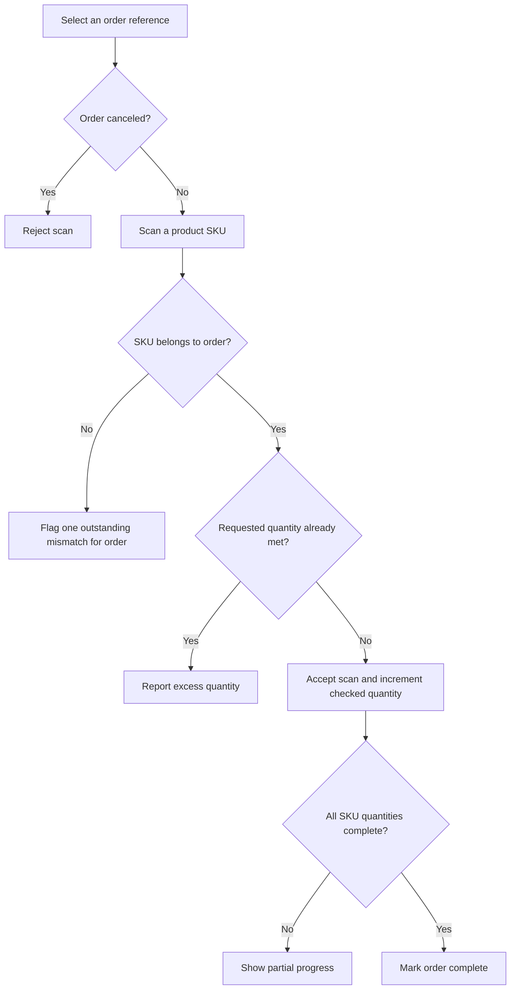

<div align="center">

# E-Commerce Order Checking System

### Verify with confidence. Track with clarity. Ship with accuracy.

**An independent Python portfolio project demonstrating order verification, SKU matching, quantity reconciliation, and transparent fulfillment progress.**


`Python` · `Order Validation` · `SKU Matching` · `Quantity Tracking` · `Unit Testing` · `Privacy-Conscious Design`

</div>

---

## Overview

Order fulfillment is more than locating an item and placing it in a box. Each shipment must be checked against its corresponding order: the correct shipping reference, the right products, the required quantities, and any exceptions that need attention. Even small mistakes—such as scanning the wrong SKU, overlooking a second box, or counting the same mismatch multiple times—can affect inventory accuracy and shipment quality.

**E-Commerce Order Checking System** explores how these challenges can be addressed through a structured, rule-driven verification workflow. The project represents an e-commerce checking process in which every order has a unique receipt/reference number, one or more product SKUs, and an expected quantity for each SKU. As items are scanned, the program validates each barcode against the selected order, updates progress, and reports the result clearly.

This repository is an **independent, synthetic-data portfolio demonstration**, not a production warehouse application. It was built to communicate the underlying problem-solving approach and to make the essential validation logic easy to read, test, and extend.

## The Problem It Solves

Manual order verification often relies on operators comparing packing lists with physical packages while keeping track of partial completion and exceptions. That introduces several potential sources of confusion:

- **Wrong-item errors:** a physically scanned barcode does not belong to the selected order.
- **Quantity ambiguity:** an order requires two boxes, but only one has been verified.
- **Duplicate exception counts:** repeatedly scanning the same wrong item makes one problematic order appear to be several separate issues.
- **Incomplete progress visibility:** a completed product line is not necessarily a completed order.
- **Cancellation confusion:** canceled orders should be distinguishable from orders that are still waiting to be checked.

The project addresses these cases through explicit states and deterministic checks, rather than relying on a vague scanned/not-scanned indicator.

## Project Objectives

1. **Improve verification accuracy** by matching a scanned SKU against the products assigned to a specific order.
2. **Protect quantity integrity** by preventing accepted scans from exceeding the requested quantity.
3. **Make partial progress visible** so incomplete orders are not mistaken for completed shipments.
4. **Count outstanding mismatches by order**, not by the number of failed scan attempts.
5. **Separate product-line completion from order completion** in operational summaries.
6. **Keep cancellation handling explicit** instead of treating canceled orders as ordinary unfinished work.
7. **Demonstrate testable business logic** using small, readable Python modules and automated unit tests.

## Implemented Features

The following functionality is included in the Python demonstration in this repository:

| Feature | How it works |
| --- | --- |
| Order identification | Each `Order` object has a unique synthetic receipt/reference identifier and marketplace label. |
| SKU validation | A scan is accepted only when its SKU exists among the order's requested items. |
| Quantity reconciliation | Each accepted scan increments the corresponding SKU's checked quantity by one. |
| Excess-quantity protection | Attempting to scan beyond the requested quantity returns `QTY LEBIH` without increasing the count. |
| Partial status | An order with at least one accepted scan, but incomplete quantities, reports `SEBAGIAN` unless an outstanding mismatch takes priority. |
| Outstanding mismatch detection | A wrong SKU returns `SALAH ARTIKEL` and marks the order as mismatched. Repeating the wrong scan does not increase the number of mismatched orders. |
| Mismatch correction | A subsequent valid and accepted SKU scan clears the demonstration's outstanding mismatch flag. |
| Cancellation handling | A canceled order rejects additional scans and is excluded from completed-order totals. |
| Product-line completion | Counts SKU lines for which the checked quantity meets the expected quantity. |
| Order completion | Counts orders only when every requested SKU has reached its expected quantity and the order is not canceled. |
| Automated tests | Unit tests verify mismatch deduplication, partial/completed quantities, and canceled-order behavior. |

> **Scope note:** The repository contains a **command-line logic demonstration**. A Windows desktop interface, smartphone camera scanner, live web API, Excel importer, persistent database, and spoken feedback are **not included in this public demo**. They are examples of possible integrations, not claims about what this repository runs today.

## How the Verification Flow Works



The most important design principle is that **a barcode scan, a completed SKU line, and a completed order are three different things**. The system measures them differently to avoid misleading totals.

## Example: One Order, Multiple Boxes

Consider a fictional order with the following contents:

| SKU | Quantity ordered | Quantity checked initially |
| --- | ---: | ---: |
| `SKU-A-40` | 2 | 0 |
| `SKU-B-41` | 1 | 0 |
| **Total boxes** | **3** | **0** |

The simulated workflow behaves as follows:

| Action | Response | Resulting order state |
| --- | --- | --- |
| Scan an unrelated SKU | `SALAH ARTIKEL` | `TIDAK MATCH` |
| Scan the same unrelated SKU again | `SALAH ARTIKEL` | Still **one** outstanding mismatched order |
| Scan `SKU-A-40` | `COCOK` | `SEBAGIAN`, 1 of 3 boxes accepted |
| Scan `SKU-A-40` again | `COCOK` | `SEBAGIAN`, 2 of 3 boxes accepted |
| Scan `SKU-B-41` | `COCOK` | `SUDAH SCAN`, all 3 boxes accepted |
| Attempt another `SKU-A-40` scan | `QTY LEBIH` | No additional accepted quantity |

In this example, two SKU lines are complete, while only **one** order is complete. Repeated wrong scans never create additional mismatched orders in the summary.

## Understanding Order Statuses

| Status | Meaning |
| --- | --- |
| `BELUM SCAN` | No accepted units have been scanned yet and no unresolved mismatch is active. |
| `SEBAGIAN` | At least one unit has been accepted, but the order is not fully complete. |
| `SUDAH SCAN` | Every SKU has reached its expected quantity. |
| `TIDAK MATCH` | The order currently has an outstanding wrong-SKU scan. |
| `CANCEL CUSTOMER` | The example order was canceled by the customer. |
| `CANCEL REJECT` | The example order was rejected. |
| `CANCEL STOCK KOSONG` | The example order was canceled due to unavailable stock. |

The demonstration stores cancellation as an optional order attribute; it does **not** implement a cancellation-management screen or audit trail. Likewise, the mismatch flag is a simplified in-memory concept, not a historical event-log processor.

## Technology Stack

| Layer | Technology | Purpose |
| --- | --- | --- |
| Programming language | **Python 3.10+** | Core validation and order-state logic |
| Data model | `dataclasses` | Readable order objects and state |
| Quantity tracking | `collections.Counter` | Per-SKU checked quantities |
| Testing | `unittest` | Repeatable checks for business rules |
| Data in this demo | Fictional in-memory orders | No real customers, shipments, or database access |

**No external Python packages are required** for the included demo.

## Repository Structure

```text
ecommerce-order-checking-system/
├── README.md                  # Project explanation and usage
├── LICENSE                    # License for this independent demo
├── .gitignore                 # Blocks common runtime data and secrets
├── assets/
│   └── app-icon.png           # Generic demonstration artwork
├── docs/
│   ├── PROJECT_OVERVIEW.md     # Project scope at a glance
│   └── GITHUB_UPLOAD.md       # Safe publishing checklist
├── src/
│   └── order_check_demo.py    # Order model and verification logic
└── tests/
    └── test_demo.py           # Automated unit tests
```

## Quick Start

### Requirements

- Python **3.10 or later**
- A terminal such as Windows Command Prompt, PowerShell, macOS Terminal, or Linux shell
- No database, network service, or additional dependency installation

### 1. Clone the repository

```bash
git clone https://github.com/YOUR-USERNAME/ecommerce-order-checking-system.git
cd ecommerce-order-checking-system
```

Replace `YOUR-USERNAME` with your GitHub username. You can also download the repository as a ZIP and extract it.

### 2. Run the example

On most systems:

```bash
python src/order_check_demo.py
```

If Python is installed as `python3`, use `python3` instead.

### 3. Run the tests

```bash
python -m unittest discover -s tests -v
```

A successful test run verifies the main demonstration rules. The exact command output may vary slightly by Python version.

### 4. Explore the code

Start with the `Order` class in `src/order_check_demo.py`. The key parts are:

- `requested`: required quantity for each SKU;
- `checked`: currently accepted quantity for each SKU;
- `scan(sku)`: validation and quantity update;
- `status`: derived status for the order;
- `complete`: true only when all requested quantities are fulfilled;
- `totals(orders)`: distinct order and SKU-line summary counts.

## Design Decisions

**1. Correctness before visual complexity.** The included example intentionally focuses on the core verification rules. It is easier to test a small logic model before connecting it to a graphical interface, scanner hardware, or database.

**2. Quantity-aware progress.** Accepting one unit from a two-unit order does not make the order complete. This prevents premature completion indicators.

**3. Deduplicated exceptions.** Ten unsuccessful SKU scans against the same order still represent one currently mismatched order in the demonstration's summary.

**4. Explicit separation of metrics.** Completed SKU lines and completed orders are calculated separately, making operational dashboards more meaningful.

**5. Cancellation is not fulfillment.** A canceled order cannot be counted as completed simply because it is no longer being processed.

## Future Development Opportunities

The following are **possible extensions, not implemented features of this public repository**:

- A polished desktop dashboard with search, date filtering, and order summaries.
- An Excel import pipeline with flexible packing-list templates and duplicate protection.
- SQLite or another persistent database with transactional updates and audit logs.
- A mobile-friendly barcode scanning interface with camera and flashlight controls.
- Per-marketplace reporting and date-based fulfillment statistics.
- Dedicated cancellation actions with role-based authorization and reversible status changes.
- User authentication, scanner-session management, and granular access permissions.
- Better concurrency controls for multiple scanners working simultaneously.
- Automated integration testing against a staging environment with generated sample orders.

A production implementation would also require stronger validation, recovery procedures, secure credential handling, observability, and a comprehensive authorization model.

## Privacy, Ethics, and Data Safety

This project deliberately uses **invented order IDs, SKUs, and marketplace labels**. The sample identifiers such as `DEMO-001` and `SKU-A-40` do not represent real shipments or customers.

The public repository is not intended to contain:

- Customer names, phone numbers, addresses, or shipping references.
- Original workplace source code, private business documentation, or commercial datasets.
- Production SQLite databases, Excel order exports, audit logs, or backups.
- Passwords, server access codes, API tokens, TLS private keys, or device addresses.
- Employer names, logos, internal branding, or proprietary assets.

The included `.gitignore` excludes common data and secret file formats, but **it is not a substitute for reviewing files before each commit**. Files already committed to Git history require separate remediation; adding them to `.gitignore` does not remove their history.

## Limitations

This is an educational portfolio demo, not a warehouse-ready product. It is in-memory only: there is no persistence between program runs, no barcode camera integration, no authenticated multi-user access, and no production-grade audit logging. The cancellation and mismatch models intentionally simplify real-world operational edge cases.

These limitations are stated openly so readers can distinguish **working demonstration code** from **product ideas and architectural direction**.

## Why This Project Matters

The value of a checking system is not merely that it accepts barcode input. The value is that it makes important business rules **consistent, understandable, and measurable**. By separating scanned units, completed lines, completed orders, and unresolved mismatches, this project demonstrates how thoughtful validation logic can reduce ambiguity in fulfillment workflows.

It also illustrates practical software-engineering habits: small domain models, explicit state transitions, defensive quantity checks, repeatable tests, and privacy-aware project sharing.

## License

The independent demonstration code in this repository is provided under the [MIT License](LICENSE). This license covers only material that is actually owned by the portfolio project author; it does not grant any rights to employer-owned or third-party intellectual property.

---

<div align="center">

**Built as a software engineering portfolio demonstration.**  
*Reliable verification starts with clear rules and trustworthy counts.*

</div>
